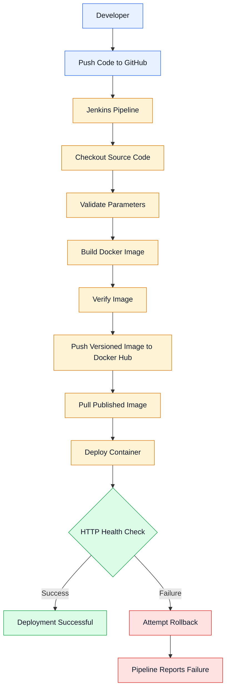

# 🚀 Automated CI/CD Pipeline for a React Application Using Jenkins, Docker & Docker Hub

<p align="center">
  
  
  
  
  
</p>

## 📌 Project Overview

This project demonstrates an automated Continuous Integration and Continuous Deployment (CI/CD) pipeline for a React application using **Jenkins, Docker, Docker Hub, and GitHub**.

The pipeline automates application checkout, Docker image creation, image verification, registry publishing, deployment, and HTTP health checks. It also implements versioned Docker images and a best-effort rollback mechanism when a deployment fails its health check.

The objective is to create a repeatable deployment workflow that reduces manual intervention, improves release traceability, and simplifies application delivery to different environments.

## 🏗️ CI/CD Architecture



### 🔄 Pipeline Workflow

1. **Source control:** Jenkins checks out the application code from the configured GitHub branch.
2. **Validation:** The pipeline checks required files, image repository details, container name, and port values.
3. **Docker build:** A Docker image is built using the project Dockerfile.
4. **Image verification:** The pipeline confirms that the generated image exists locally.
5. **Registry publishing:** Jenkins authenticates to Docker Hub using credentials stored in Jenkins and pushes the versioned image.
6. **Image pull:** Jenkins pulls the published image from Docker Hub.
7. **Deployment:** The existing application container is replaced with a container running the published image.
8. **Health check:** The pipeline checks whether the application responds over HTTP.
9. **Rollback:** If the health check fails, Jenkins attempts to restore the previous image and marks the deployment as failed.

## 🛠️ Technology Stack

| Technology | Purpose |
|---|---|
| Git & GitHub | Source code management and version control |
| Jenkins | CI/CD pipeline orchestration |
| Docker | Application containerization |
| Docker Hub | Docker image registry |
| React | Frontend application |
| TypeScript | Type-safe JavaScript development |
| Vite | Frontend development and production build |
| Node.js | Application build environment |
| Linux | Container execution and deployment environment |

## ✨ Key Features

- Automated CI/CD pipeline using a `Jenkinsfile`.
- Multi-stage Docker build to separate the build environment from the runtime image.
- Versioned Docker images generated using the Jenkins build number.
- Automated image publishing and retrieval through Docker Hub.
- Parameterized configuration for the image repository, container name, and ports.
- Jenkins credential management for Docker Hub authentication.
- HTTP health checks with retries before declaring deployment successful.
- Best-effort rollback to the previous image when deployment verification fails.
- Container restart policy configured with `unless-stopped`.

## 📂 Project Structure

```text
Full-stack-application-with-Docker-Registry/
├── public/                 # Public frontend assets
├── src/                    # React application source code
├── Dockerfile              # Multi-stage Docker build
├── Jenkinsfile             # CI/CD pipeline definition
├── package.json            # Application dependencies and scripts
├── package-lock.json       # Dependency lock file
├── vite.config.ts          # Vite configuration
├── tsconfig.json            # TypeScript configuration
└── README.md               # Project documentation
```

## 🐳 Docker Implementation

The project uses a multi-stage Dockerfile.

### Stage 1: Build the application

- Uses Node.js 22 Alpine.
- Installs dependencies using `npm ci`.
- Copies the application source code.
- Generates production assets using `npm run build`.

### Stage 2: Run the application

- Uses a separate Node.js 22 Alpine image.
- Installs the `serve` utility.
- Copies only the generated `dist` directory from the build stage.
- Exposes container port `3000`.
- Starts the production frontend server.

This approach avoids copying the complete source tree and build dependencies into the final runtime image. However, frontend production assets are still accessible to browsers and should not be treated as confidential.

## ⚙️ Jenkins Pipeline Configuration

The pipeline is defined in the root-level `Jenkinsfile`.

### Jenkins parameters

| Parameter | Purpose | Default |
|---|---|---|
| `DOCKERHUB_REPO` | Docker Hub image repository | `ganeshsuryawanshi12345/website` |
| `CONTAINER_NAME` | Name of the running container | `website-container` |
| `HOST_PORT` | Port exposed on the host | `3000` |
| `CONTAINER_PORT` | Application container port | `3000` |

The image tag is generated automatically from the Jenkins build number.

For example:

```text
Jenkins Build #6  → website:v6
Jenkins Build #7  → website:v7
Jenkins Build #8  → website:v8
```

The actual image reference includes the registry namespace:

```text
ganeshsuryawanshi12345/website:v8
```

The tag represents the Jenkins build number, not necessarily a semantic software release number. A new tag may be generated even when the source code has not changed.

### Required Jenkins setup

1. Configure the GitHub repository and branch in the Jenkins job.
2. Ensure Jenkins has permission to execute Docker commands.
3. Add a Jenkins username/password credential with the ID `dockerhub-creds`.
4. Use a Docker Hub access token as the credential password.
5. Ensure the Docker Hub repository exists and the credential has the required permissions.
6. Configure the job to load the `Jenkinsfile` from the repository.
7. Run a build and inspect the Console Output for each pipeline stage.

**Security note:** Access to the Docker daemon is highly privileged. Restrict Jenkins access, credential permissions, and Docker socket access appropriately.

## 🚀 Run the Application Locally

### Prerequisites

- Git
- Docker Engine
- Access to the project repository

### 1. Clone the repository

```bash
git clone https://github.com/Ganesh4365/Full-stack-application-with-Docker-Registry.git

cd Full-stack-application-with-Docker-Registry
```

### 2. Build the Docker image

```bash
docker build -t website-image:local .
```

### 3. Start the container

```bash
docker run -d \
  --name website-container \
  --restart unless-stopped \
  -p 3000:3000 \
  website-image:local
```

### 4. Verify the deployment

Open `http://localhost:3000` in your browser, or run:

```bash
curl -I http://localhost:3000
```

Check container status and logs:

```bash
docker ps

docker logs website-container
```

To stop and remove the local test container:

```bash
docker rm -f website-container
```

> Run the cleanup command only when you intend to remove that container. Avoid using it on a shared or production server without confirming which application is running.

## 📦 Deploy a Published Docker Image

A server can run a published image without checking out the GitHub repository, provided it has access to the registry and image.

For a private Docker Hub repository, authenticate using an appropriately scoped access token. Avoid putting credentials directly in shell commands, scripts, or Git.

Pull the desired image:

```bash
docker pull ganeshsuryawanshi12345/website:v8
```

Deploy it:

```bash
docker run -d \
  --name website-container \
  --restart unless-stopped \
  -p 3000:3000 \
  ganeshsuryawanshi12345/website:v8
```

Replace `v8` with the actual published version you intend to deploy.

For production environments, review port exposure, firewall rules, TLS termination, registry access, environment configuration, and rollback requirements before deployment.

## 🔍 Troubleshooting

| Issue | Diagnostic command |
|---|---|
| Container is not running | `docker ps -a` |
| Application is not responding | `curl -v http://localhost:3000` |
| Application startup failure | `docker logs website-container` |
| Image is missing locally | `docker images` |
| Incorrect image version | `docker inspect --format '{{.Config.Image}}' website-container` |
| Registry authentication failure | `docker login` |
| Jenkins pipeline failure | Review the failed stage in Jenkins Console Output |

A container showing `Up` does not guarantee that the application is healthy. Always verify the application response and inspect logs when a health check fails.

## 🔐 Security Considerations

- Never commit registry tokens, passwords, or other secrets to GitHub.
- Store credentials in Jenkins Credentials and use appropriately scoped access tokens.
- Keep private application images in a private registry when required.
- Use explicit image versions rather than relying exclusively on `latest`.
- Keep the runtime image minimal and avoid copying development files into it.
- Do not embed secrets in frontend code or Docker image layers.
- Restrict access to Jenkins, the Docker daemon, and deployment servers.
- Scan dependencies and container images for vulnerabilities before production deployment.
- Treat rollback as a recovery mechanism that must be tested, not as a guarantee of zero downtime.

## 📈 Future Improvements

Potential improvements for a production-ready implementation include:

- Automated unit tests and linting before image publication.
- Docker image vulnerability scanning.
- Image tagging with the Git commit SHA for traceability.
- Deployment to separate development, staging, and production environments.
- Blue-green deployment to reduce downtime.
- Automated notifications for deployment success or failure.
- Centralized logs, application metrics, and alerting.
- Automated retention and cleanup of old Docker images.

## 🎯 What This Project Demonstrates

This project demonstrates practical experience with:

- Building a CI/CD pipeline using Jenkins Declarative Pipeline.
- Containerizing a frontend application using Docker.
- Publishing and retrieving versioned images from Docker Hub.
- Managing CI/CD credentials.
- Deploying applications on Linux using Docker.
- Implementing HTTP health checks and failure handling.
- Troubleshooting image, container, and deployment issues.
- Documenting a repeatable application delivery workflow.

## 👨‍💻 Author

**Ganesh Suryawanshi**

DevOps | Cloud Engineering | CI/CD Automation

- **GitHub:** [Ganesh4365](https://github.com/Ganesh4365)
- **Project Repository:** [Full-stack Application with Docker Registry](https://github.com/Ganesh4365/Full-stack-application-with-Docker-Registry)

---

<p align="center">
  <i>Automate the build. Version every release. Verify every deployment.</i>
</p>
